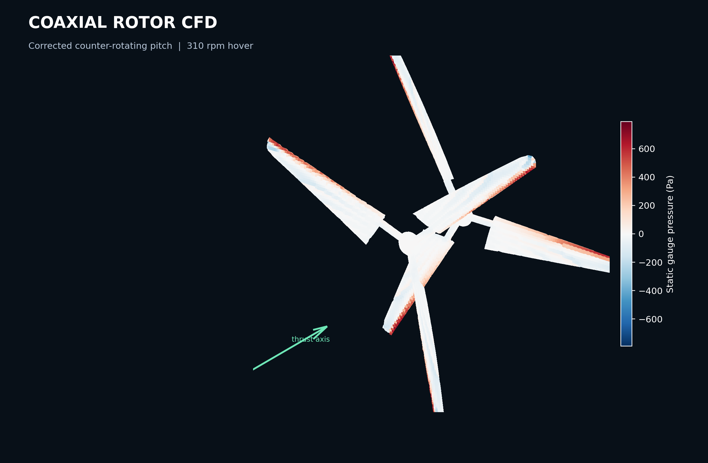
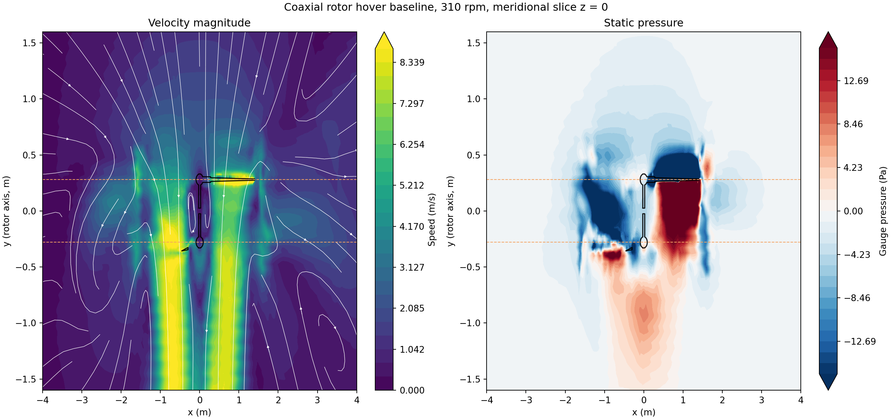
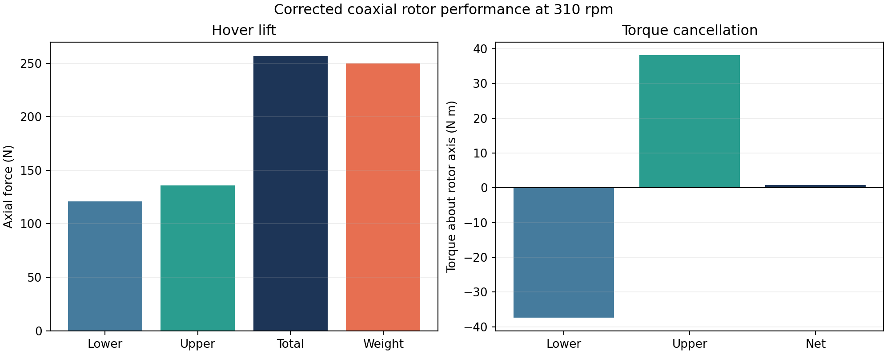

# Coaxial Rotor CFD

A reproducible, open-source CFD workflow for the SolidWorks coaxial-rotor
assembly in this repository. The project converts the native geometry,
assembles the actual blade surfaces, runs a blade-resolved OpenFOAM MRF case,
and post-processes the flow field and rotor loads.

[](LICENSE)
[](https://www.openfoam.com/)
[](docs/VALIDATION.md)



## Why this project exists

The supplied assembly contains two three-blade rotors, a 1.40 m tip radius,
a 0.27 m root radius, and a 0.56 m stage separation. Running the as-modeled
assembly with the two stages counter-rotating produced nearly equal and
opposite axial forces: roughly 0.8–0.9 kN on each stage but almost zero net
lift.

The cause is the upper-stage pitch direction. Mirroring only the upper blades
about their rotor plane produced a torque-balanced, lifting coaxial pair.
This repository documents both the original result and the corrected
engineering baseline.

## Key result

The corrected rotor was evaluated in quiescent hover at 310 rpm, where the
blade-tip Mach number is approximately 0.13.

| Metric | Result |
| --- | ---: |
| Lower-rotor lift | 121.06 N |
| Upper-rotor lift | 136.01 N |
| Total lift | **257.07 N** |
| 25.49 kg assembly weight | 249.97 N |
| Lift-to-weight ratio | 1.028 |
| Net shaft reaction torque | **0.84 N·m** |
| Estimated shaft power | 2.45 kW |
| Estimated figure of merit | 0.436 |
| Solver iterations reported | 300 |

At iteration 300, the maximum velocity residual component was `1.06e-4`,
the pressure residual was `9.50e-6`, and the local continuity error was
`1.97e-6`. The total lift changed by less than 0.03% between iterations
200 and 300.





## Workflow

```text
SolidWorks assembly
        │
        ▼
Native geometry inspection and Parasolid extraction
        │
        ▼
Trimmed surface triangulation and mesh repair
        │
        ▼
Corrected coaxial rotor STL
        │
        ▼
blockMesh + snappyHexMesh
        │
        ▼
simpleFoam + steady MRF + kOmegaSST
        │
        ▼
VTK fields, pressure/shear integration, and reproducible report
```

## Features

- Parse the modern SolidWorks assembly without requiring a full SolidWorks CFD
  installation for the downstream analysis.
- Preserve the actual blade CAD surfaces through a triangulation and repair
  pipeline.
- Rebuild the exact component placement from the assembly transform matrices.
- Run a full 360-degree, blade-resolved steady MRF case.
- Export OpenFOAM field data to VTK.
- Recompute pressure and wall-shear loads from the exported boundary meshes.
- Provide a complete case archive and concise validation evidence.

## Repository layout

```text
.
├── CFD_output/
│   ├── assemble_rotor.py
│   ├── triangulate_faces.py
│   ├── compute_total_forces.py
│   ├── visualize_openfoam.py
│   ├── render_surface.py
│   ├── geometry/                 # Converted and corrected STL geometry
│   └── results/                  # Figures, JSON summaries, VTK and logs
├── cases/
│   ├── coaxial_hover_310rpm/     # Corrected hovering configuration
│   └── as_modeled_800rpm/        # Original counter-rotating comparison
├── docs/
│   ├── images/
│   ├── METHODOLOGY.md
│   └── VALIDATION.md
├── 共轴双旋翼.SLDASM
├── 桨叶.SLDPRT
└── 桨毂.SLDPRT
```

## Quick start

### 1. Requirements

- OpenFOAM v1912
- Python 3.10+
- NumPy, SciPy, Matplotlib, trimesh, pymeshfix, triangle, gmsh and VTK
- CMake and a C++20 compiler only when rebuilding the native CAD utilities

Install the Python dependencies:

```bash
python -m pip install -r requirements.txt
```

### 2. Run the prepared case

```bash
source /path/to/OpenFOAM-v1912/etc/bashrc
cd cases/coaxial_hover_310rpm
./run.sh
```

The script creates the mesh, extracts sharp features, runs `snappyHexMesh`,
checks the mesh, creates the MRF cell zones, and runs `simpleFoam`.

### 3. Post-process

```bash
./postprocess.sh 300
```

This writes the rotor-surface and volume VTK files and recomputes forces and
moments.

The complete generated case, including mesh and time directories, is available
from the repository release assets because it exceeds the size appropriate for
normal source control.

[Download the full case, VTK data and technical report from v0.1.0](https://github.com/ZhuangHT-1201/coaxial-rotor-cfd/releases/tag/v0.1.0).

## Geometry

The converted blade mesh has a volume of `0.00292383 m³`; the SolidWorks mass
property record is `0.00294411 m³`, a difference of about `0.69%`.

The hub in the legacy conversion path contains several trimmed rotational
surfaces that the open-source converter cannot reproduce reliably. The public
case therefore uses a closed, dimension-matched three-arm hub fairing. The
blades remain the converted CAD surfaces.

See [Geometry pipeline](docs/GEOMETRY_PIPELINE.md) for conversion details.

## Validation status

The final run is an engineering screening baseline:

- The flow is steady MRF, not transient sliding-mesh CFD.
- No boundary-layer prism stack is present.
- Wall shear is estimated from the first-cell velocity gradient and the
  wall-function viscosity.
- The hub is simplified.
- `checkMesh` reports one high-skew face and a group of concave polyhedral
  cells.

See [Validation](docs/VALIDATION.md) for the complete evidence and caveats.

## Design implication

For a functional counter-rotating coaxial rotor, the upper blade pitch must be
mirrored relative to the lower stage when the same blade part is reused. In
the unmodified assembly, opposite rotation creates opposing thrust. This is a
geometry/installation issue, not a mesh-only artifact.

## Citation

If this project helps your work, see [CITATION.cff](CITATION.cff).

## Contributing

Contributions are welcome. Read [CONTRIBUTING.md](CONTRIBUTING.md) before
opening an issue or pull request.

## License

Released under the MIT License. See [LICENSE](LICENSE).

Third-party software remains under its own license; see
[THIRD_PARTY_NOTICES.md](THIRD_PARTY_NOTICES.md).
